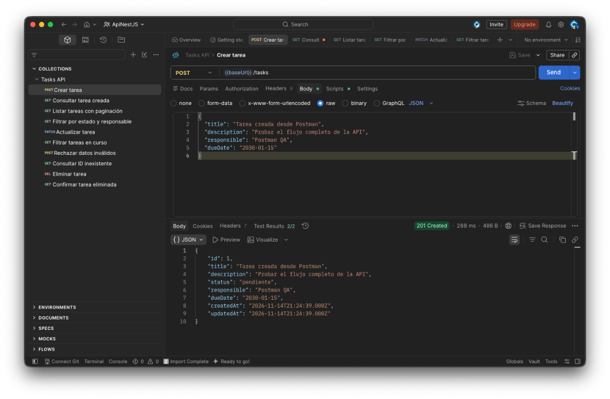
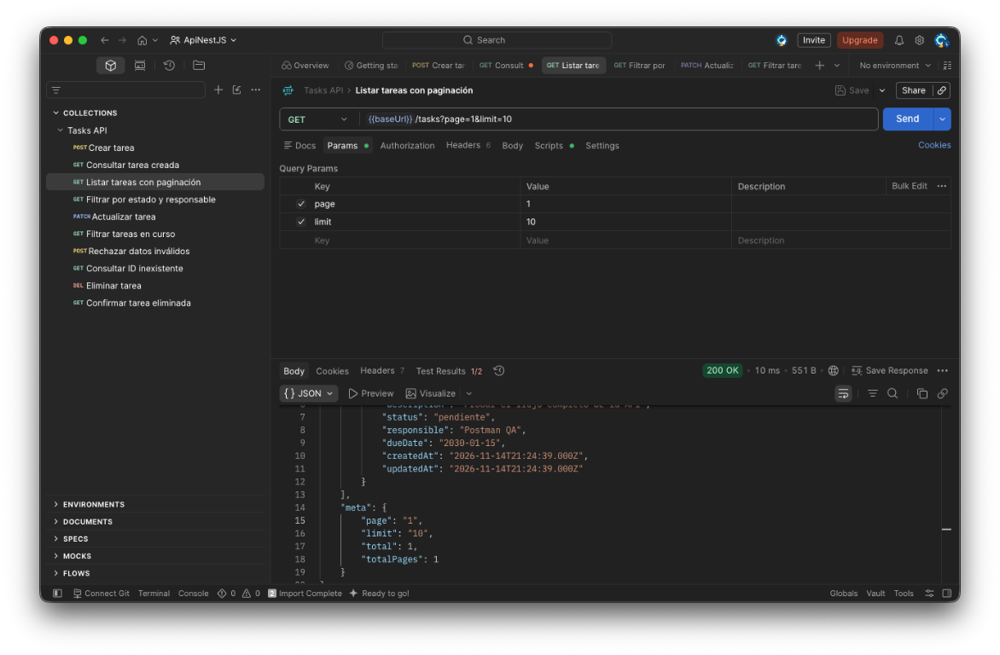
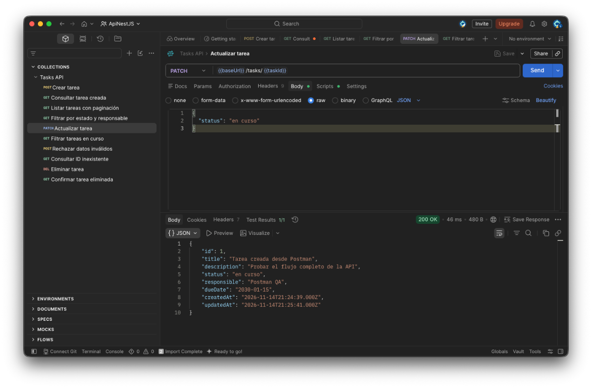
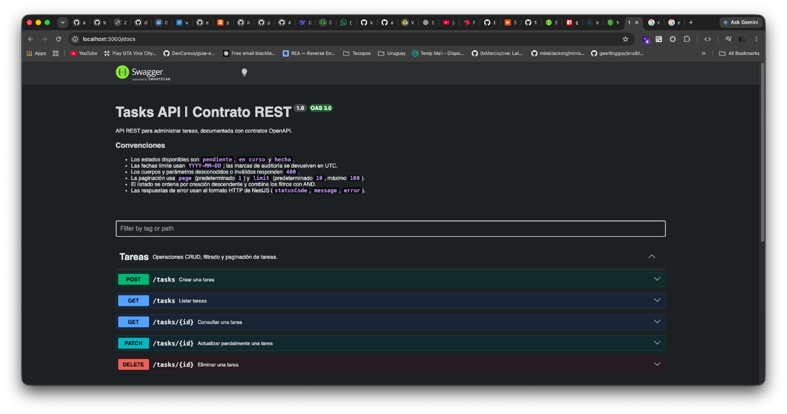

# Tasks API

API REST para administrar tareas, construida con NestJS y TypeScript. Incluye persistencia con TypeORM, SQLite para desarrollo, PostgreSQL para producción, validación de entradas, migraciones y documentación OpenAPI.

<p align="center">
  
  
  
</p>
<p align="center"><em>Ejemplos de creación, listado paginado y actualización desde Postman.</em></p>

## Funcionalidades

- CRUD de tareas: crear, listar, consultar, actualizar y eliminar.
- Filtros por estado y responsable, con paginación por página.
- Validacion estricta de cuerpos, parametros y consultas; errores HTTP consistentes.
- SQLite en desarrollo y PostgreSQL en produccion, con migraciones TypeORM.
- Swagger UI y documento OpenAPI.
- Coleccion Postman con solicitudes y aserciones automatizadas.
- Docker Compose y workflow de CI para build, pruebas y lint.

## Arquitectura

La aplicación sigue una arquitectura modular de NestJS y separa el transporte HTTP, la lógica de tareas y el acceso a datos:

```text
src/
├── main.ts
├── app.module.ts
├── app-setup.ts
├── database/
│   ├── database.module.ts
│   ├── database-options.ts
│   ├── data-source.ts
│   └── migrations/
└── tasks/
    ├── constants/
    ├── dto/
    ├── types/
    ├── task.entity.ts
    ├── tasks.controller.ts
    ├── tasks.module.ts
    ├── tasks.service.ts
    └── tasks.service.spec.ts

test/
└── tasks.e2e-spec.ts

postman/
└── tasks-api.postman_collection.json

docs/
└── images/postman/
```

### Flujo de una solicitud

1. `main.ts` inicia NestJS y delega en `app-setup.ts` el registro de la validación global y Swagger (`/docs`).
2. `TasksController` expone las rutas REST y valida las entradas con esquemas Zod mediante Standard Schema.
3. `TasksService` implementa las operaciones, filtros, paginación y respuestas `404` para tareas inexistentes.
4. El repositorio TypeORM accede a la entidad `Task`; su implementacion de base de datos depende de `NODE_ENV`.
5. `DatabaseModule` crea y comparte el `DataSource`, carga `.env` cuando existe y cierra la conexion al apagar la aplicacion.

`synchronize` permanece desactivado: los cambios del esquema se gestionan mediante migraciones. El modulo de tareas crea un proveedor de repositorio TypeORM a partir del `DataSource` compartido.

## Estructura del proyecto

| Ruta | Responsabilidad |
| --- | --- |
| `src/main.ts` | Bootstrap de NestJS. |
| `src/app-setup.ts` | Configuracion compartida de validacion Standard Schema y Swagger para la aplicación y las pruebas e2e. |
| `src/app.module.ts` | Modulo raiz; conecta base de datos y modulo de tareas. |
| `src/database/` | Opciones SQLite/PostgreSQL, ciclo de vida del `DataSource` y migraciones. |
| `src/tasks/tasks.controller.ts` | Rutas HTTP, validacion de parametros y documentacion de operaciones. |
| `src/tasks/tasks.service.ts` | Lógica de aplicación y acceso al repositorio de tareas. |
| `src/tasks/task.entity.ts` | Mapeo TypeORM de la tabla `tasks`. |
| `src/tasks/dto/` | Esquemas Zod y tipos de entrada para cada operación. |
| `src/tasks/types/` | Tipos de dominio, incluido el estado de una tarea. |
| `src/tasks/constants/` | Tokens de inyeccion del modulo de tareas. |
| `src/tasks/tasks.service.spec.ts` | Pruebas unitarias del servicio. |
| `test/tasks.e2e-spec.ts` | Pruebas HTTP end-to-end con SQLite en memoria. |
| `postman/` | Coleccion importable para probar la API manualmente o con el Collection Runner. |
| `docs/images/postman/` | Capturas de ejemplos de uso en Postman. |
| `.github/workflows/ci.yml` | Build, pruebas y lint en GitHub Actions. |
| `Dockerfile`, `compose.yaml` | Imagen de la API y servicios locales en contenedores. |

## Stack y decisiones técnicas

| Componente | Uso |
| --- | --- |
| Node.js y TypeScript ESM | Runtime y lenguaje; imports relativos con extensión `.js`. Se requiere Node.js 20.19+, 22.13+ o 24.11+; la imagen Docker usa Node.js 26. |
| NestJS 12 | Modulos, controladores, inyeccion de dependencias y codigos HTTP. |
| Zod 4 | Esquemas de validacion Standard Schema para cuerpos, rutas y consultas. |
| TypeORM | Entidades, repositorios y migraciones compartidas por ambos motores. |
| SQLite / PostgreSQL | SQLite fuera de produccion; PostgreSQL con `NODE_ENV=production`. |
| Vitest y Supertest | Pruebas unitarias y de API HTTP. |
| Swagger / OpenAPI | Documentación interactiva y contrato JSON de la API. |

La fecha límite usa el formato ISO `YYYY-MM-DD`. Los estados permitidos son `pendiente`, `en curso` y `hecha`; al crear una tarea el estado predeterminado es `pendiente`. El responsable se almacena como texto porque el alcance no define un catálogo de usuarios.

## Requisitos

- Node.js 20.19+, 22.13+ o 24.11+ y npm (versiones compatibles con TypeORM 1.1).
- Docker con el plugin Docker Compose, si se ejecuta en contenedores.
- PostgreSQL si se ejecuta directamente en produccion.

## Ejecucion local

```bash
cp .env.example .env
npm ci
npm run start:dev
```

La configuración predeterminada de `.env.example` usa SQLite y guarda el archivo `tasks.sqlite` en la raíz. La aplicación carga `.env` al arrancar; el archivo `.env` local está excluido de Git.

La API queda disponible en `http://localhost:3000`.

## Configuracion de base de datos

La seleccion del motor depende de `NODE_ENV`:

| Entorno | Base de datos | Configuracion |
| --- | --- | --- |
| Distinto de `production` | SQLite | `SQLITE_DATABASE` opcional; por defecto `tasks.sqlite`. |
| `production` | PostgreSQL | Requiere `DB_HOST`, `DB_NAME`, `DB_USER` y `DB_PASSWORD`. `DB_PORT` usa `5432` por defecto; `DB_SSL=true` activa SSL. |

Las migraciones pendientes se aplican automáticamente fuera de producción. En producción, ejecuta las migraciones como paso de despliegue antes de iniciar la API:

```bash
npm run migration:run
```

Para revertir la migracion mas reciente:

```bash
npm run migration:revert
```

## Docker Compose

Levanta la API y PostgreSQL con:

```bash
docker compose up --build
```

Compose lee `.env`. Con la configuración predeterminada, la API usa SQLite persistido en el volumen `sqlite_data`; con `NODE_ENV=production`, usa PostgreSQL en el servicio `db`. PostgreSQL conserva sus datos en `postgres_data`. Compose espera a que PostgreSQL esté saludable y aplica las migraciones antes de iniciar la API.

Detener los servicios:

```bash
docker compose down
```

Eliminar tambien los datos persistidos:

```bash
docker compose down --volumes
```

Las credenciales predeterminadas de `.env.example` son solo para desarrollo local. Reemplázalas por valores seguros antes de usar PostgreSQL en un entorno real.

## API REST

| Método | Ruta | Acción |
| --- | --- | --- |
| `POST` | `/tasks` | Crear una tarea. |
| `GET` | `/tasks` | Listar y filtrar tareas. |
| `GET` | `/tasks/:id` | Consultar una tarea. |
| `PATCH` | `/tasks/:id` | Actualizar parcialmente una tarea. |
| `DELETE` | `/tasks/:id` | Eliminar una tarea. |

Una tarea contiene `title`, `description`, `status`, `responsible` y `dueDate`.

Ejemplo de creacion:

```json
{
  "title": "Preparar entrega",
  "description": "Revisar los cambios antes de publicar",
  "responsible": "Manuel",
  "dueDate": "2030-01-15",
  "status": "pendiente"
}
```

`GET /tasks` acepta `status`, `responsible`, `page` y `limit`. La paginación empieza en 1, usa `limit=10` por defecto, limita `limit` a 100 y `page` a 1.000.000. La respuesta incluye `data` y `meta` con `page`, `limit`, `total` y `totalPages`. Una página fuera del total devuelve `data` vacío.

```text
GET /tasks?status=en%20curso&responsible=Manuel&page=1&limit=10
```

La API devuelve `201` al crear, `200` al consultar o actualizar, `204` al eliminar, `400` ante entradas inválidas y `404` cuando no existe la tarea solicitada.

## Documentación Swagger

Con la API en marcha:

- Swagger UI: `http://localhost:3000/docs`
- Especificación OpenAPI JSON: `http://localhost:3000/docs-json`

<p align="center">
  
</p>
<p align="center"><em>Documentación interactiva de Tasks API generada con Swagger.</em></p>

La documentación describe los cuerpos de creación y actualización, el modelo completo de tarea, las respuestas paginadas y el formato de errores. También muestra los filtros y límites de paginación, los valores permitidos para `status`, ejemplos y los códigos HTTP de cada operación.

## Probar con Postman

1. Inicia la API localmente o con Docker Compose.
2. En Postman, selecciona **Import** y elige [tasks-api.postman_collection.json](./postman/tasks-api.postman_collection.json).
3. La variable `baseUrl` usa `http://localhost:3000`; cámbiala si la API corre en otra dirección.
4. Ejecuta la colección con **Run** en el orden definido. Los scripts de prueba guardan el ID creado y verifican CRUD, filtros, paginación y errores HTTP.

La colección elimina al final la tarea que crea. Las capturas anteriores muestran tres de las solicitudes; hay más ejemplos en `docs/images/postman/`.

## Pruebas y CI

```bash
npm test              # pruebas unitarias
npm run test:e2e      # pruebas HTTP end-to-end (SQLite en memoria)
npm run build         # compilación
npm run lint          # lint y comprobación de tipos
```

Las pruebas unitarias cubren creación, filtros/paginación y errores de recurso inexistente. Las pruebas e2e cubren orden estable y páginas sin duplicados, filtros combinados, parámetros inválidos, normalización, actualizaciones parciales sin escrituras inválidas y códigos `400`/`404`. GitHub Actions ejecuta build, ambas suites de pruebas y lint en cada `push` y pull request. El workflow está en `.github/workflows/ci.yml`.

## Decisiones y siguientes pasos

- Se eligió NestJS por su arquitectura modular, inyección de dependencias nativa y herramientas integradas para validación, pruebas y documentación de APIs.
- Se usó un responsable de texto y una fecha límite sin hora para mantener simple el modelo solicitado.
- Se compartió la migración entre SQLite y PostgreSQL; no se usa sincronización automática del esquema.

## Uso de IA

La IA se utilizó como apoyo durante distintas etapas del desarrollo, con solicitudes acotadas y revisión de los resultados:

1. **Modelo y persistencia:** definir la entidad de tarea, organizar sus DTOs y tipos, y configurar TypeORM con SQLite para desarrollo y PostgreSQL para producción.
2. **Comportamiento de la API:** implementar las operaciones CRUD, filtros, paginación, validación de entradas y respuestas HTTP apropiadas.
3. **Ejecución y calidad:** preparar Docker Compose, migraciones, pruebas unitarias y e2e, y el workflow de CI.
4. **Integración y documentación:** añadir Swagger, una colección Postman y documentación de arquitectura y ejecución.

### Decisiones aceptadas y revisiones

- Se conservó una estructura modular de NestJS y se desactivó la sincronización automática del esquema; los cambios de base de datos se administran mediante migraciones.
- Se usó SQLite en memoria para las pruebas e2e y PostgreSQL para producción, con configuración separada según el entorno.
- La validación con Zod se integró mediante `StandardSchemaValidationPipe`. Las pruebas e2e ayudaron a detectar que debía registrarse globalmente para que se aplicaran correctamente las transformaciones y validaciones de los parámetros.
- Se ajustó el driver de SQLite a `better-sqlite3` al comprobar que la versión de TypeORM instalada no aceptaba el tipo `sqlite`.
- Se endureció la validación de paginación e identificadores, incluyendo entradas como números fraccionarios, valores fuera de rango y parámetros repetidos o desconocidos.
- Se amplió el contrato OpenAPI con esquemas, ejemplos y respuestas documentadas. La prueba del documento se adaptó al resultado real de Swagger: los esquemas de entrada derivados de Zod se publican inline, mientras que las respuestas reutilizan referencias a modelos.

Las propuestas de la IA se contrastaron con el código existente, los tipos de las dependencias y las pruebas. Se modificaron o descartaron las que no coincidían con el comportamiento real del proyecto.

### Qué añadiría con más tiempo

- Ejecutar pruebas de integración y migraciones contra una instancia real de PostgreSQL en CI, además de SQLite.
- Incorporar autenticación y autorización; si las tareas pertenecen a usuarios, asociarlas mediante un identificador en lugar de tratar `responsible` solo como texto.
- Añadir controles de concurrencia para evitar que una actualización sobrescriba silenciosamente cambios recientes.
- Incorporar métricas, trazas y verificaciones de salud para facilitar la operación y el diagnóstico en producción.

## Tiempo dedicado

Tiempo total para completar la prueba técnica: **2 horas y 50 minutos**.
